<div align="center">

  <!-- ================= BANNER WITH SUSHMITA MOVING RAY & DUAL-TONE NEON ACCENTS ================= -->
  

  <br/><br/>

  <!-- ================= DYNAMIC TYPING SUBTITLE (NO HAND EMOJI) ================= -->
  <a href="https://git.io/typing-svg">
    
  </a>

  <br/>

  <!-- ================= SOCIAL BADGES ================= -->
  <p align="center">
    <a href="https://linkedin.com/in/aryan-gupta-58a99834a" target="_blank">
      
    </a>&nbsp;
    <a href="mailto:aryann.gupta.1ii@gmail.com" target="_blank">
      
    </a>&nbsp;
    <a href="https://leetcode.com/u/_aryan1i/" target="_blank">
      
    </a>&nbsp;
    <a href="https://codeforces.com/profile/aryan_1ii" target="_blank">
      
    </a>&nbsp;
    <a href="https://www.codechef.com/users/aryan_1ii" target="_blank">
      
    </a>&nbsp;
    <a href="https://www.geeksforgeeks.org/user/aryanngu56c8/" target="_blank">
      
    </a>
  </p>

  <br/>

  <!-- ================= QUICK NAVIGATION PILLS ================= -->
  <p align="center">
    <a href="#about"></a>&nbsp;
    <a href="#recognition"></a>&nbsp;
    <a href="#toolkit"></a>&nbsp;
    <a href="#cp-arena"></a>&nbsp;
    <a href="#commits"></a>&nbsp;
    <a href="#analytics"></a>&nbsp;
    <a href="#work"></a>&nbsp;
    <a href="#connect"></a>
  </p>

  <br/>

  <!-- Profile Views -->
  

</div>

<br/><br/>

<!-- ====================================================== -->
<!--                      01 // ABOUT                       -->
<!-- ====================================================== -->

<a name="about"></a>


<br/><br/>

<!-- Interactive Terminal Dossier & Highlight Cards with Moving Border Ray -->


<br/><br/>

<details>
<summary><b>📋 View Full Machine-Readable Profile Dossier (YAML)</b></summary>

```yaml
identity:
  name: Aryan Gupta
  role: B.Tech Computer Science Student & Backend Engineer
  location: Bengaluru, India 🇮🇳
  institution: PW Institute of Innovation (Medhavi Skills University)
  graduation: 2025 - 2029 (Currently Semester 3)

interests & focus:
  - Data Structures & Algorithms
  - Backend Engineering & Database Architecture
  - Competitive Programming
  - Distributed Systems & Scalability

achievements:
  - total_problems_solved: 800+ unique problems across LC, GFG, CC, CF
  - leetcode_daily_streak: 300+ days continuous practice 🔥
  - peak_leetcode_rating: 1592
  - codechef_rating: 1268
  - icpc_india_preliminary_2026: Tentative Rank 1168

current_focus:
  - Advanced Spring Boot & Relational Entity Architecture
  - Asymptotic Graph Theory & Dynamic Programming optimizations
  - System Design & Low-Latency Transaction Management

philosophy:
  mantra: "Get hired for what you build, not where you study."
  code_dna: "If you're disciplined, you still can't beat someone who's obsessed."
  availability: "Open for Software Engineering Internships & Open-Source Collaboration"
```

</details>

<br/><br/>

<!-- ====================================================== -->
<!--                   02 // RECOGNITION                    -->
<!-- ====================================================== -->

<a name="recognition"></a>


<br/><br/>

<!-- Sushmita-Style Bespoke Recognition Grid with Moving Border Rays -->


<br/><br/>

<!-- ====================================================== -->
<!--                    03 // TOOLKIT                       -->
<!-- ====================================================== -->

<a name="toolkit"></a>


<br/><br/>

<!-- Sushmita-Style Tech Constellation Card with Moving Border Ray -->


<br/><br/>

<!-- ====================================================== -->
<!--                   04 // CP ARENA                       -->
<!-- ====================================================== -->

<a name="cp-arena"></a>


<br/><br/>

<div align="center">

  <!-- Interactive LeetCode & CodeChef Battle Cards -->
  <a href="https://leetcode.com/u/_aryan1i/" target="_blank">
    
  </a>&nbsp;&nbsp;
  <a href="https://www.codechef.com/users/aryan_1ii" target="_blank">
    
  </a>

  <br/><br/>

  <!-- CP Platform Badges -->
  <p align="center">
    <a href="https://leetcode.com/u/_aryan1i/" target="_blank">
      
    </a>&nbsp;
    <a href="https://codeforces.com/profile/aryan_1ii" target="_blank">
      
    </a>&nbsp;
    <a href="https://www.codechef.com/users/aryan_1ii" target="_blank">
      
    </a>&nbsp;
    <a href="https://www.geeksforgeeks.org/user/aryanngu56c8/" target="_blank">
      
    </a>
  </p>

</div>

<br/><br/>

<!-- ====================================================== -->
<!--                  05 // COMMIT LOG                      -->
<!-- ====================================================== -->

<a name="commits"></a>


<div align="center">

  <br/><br/>

  <!-- Avi Vashishta Pop-Wave Landing Reveal + Sushmita Serpentine Snake + Moving Border Ray -->
  

</div>

<br/><br/>

<!-- ====================================================== -->
<!--                   06 // ANALYTICS                      -->
<!-- ====================================================== -->

<a name="analytics"></a>


<div align="center">

  <br/><br/>

  <!-- Obsidian & Cyber Cyan Brand-Matched GitHub Metrics Cards -->
  <a href="https://github.com/Aryan1i" target="_blank">
    
  </a>&nbsp;&nbsp;
  <a href="https://github.com/Aryan1i" target="_blank">
    
  </a>

</div>

<br/><br/>

<!-- ====================================================== -->
<!--                07 // SELECTED WORK                     -->
<!-- ====================================================== -->

<a name="work"></a>


<div align="center">

  <br/><br/>

  <!-- High-End 2x2 Bento Showcase Card with Moving Border Ray -->
  

  <br/><br/>

  <!-- Direct Repository Launch Badges -->
  <p align="center">
    <a href="https://github.com/Aryan1i/CodeDNA" target="_blank">
      
    </a>&nbsp;
    <a href="https://github.com/Aryan1i/springboot/tree/main/JDBC-CRUD-Project/src" target="_blank">
      
    </a>&nbsp;
    <a href="https://github.com/Aryan1i/springboot/tree/main/JDBC-Learning/src" target="_blank">
      
    </a>&nbsp;
    <a href="https://github.com/Aryan1i/DSA" target="_blank">
      
    </a>
  </p>

</div>

<br/><br/>

<!-- ====================================================== -->
<!--                    08 // CONNECT                       -->
<!-- ====================================================== -->

<a name="connect"></a>


<div align="center">

  <br/><br/>

  <!-- Aesthetic Developer Workspace Animation (Dark Cyberpunk Theme) -->
  <p align="center">
    
  </p>

  <br/><br/>

  <!-- Sushmita-Style Philosophy Signature Card with Moving Border Ray & Editorial Typography -->
  

  <br/><br/>

  <!-- Subtle Cyberpunk Footer Wave -->
  

</div>
