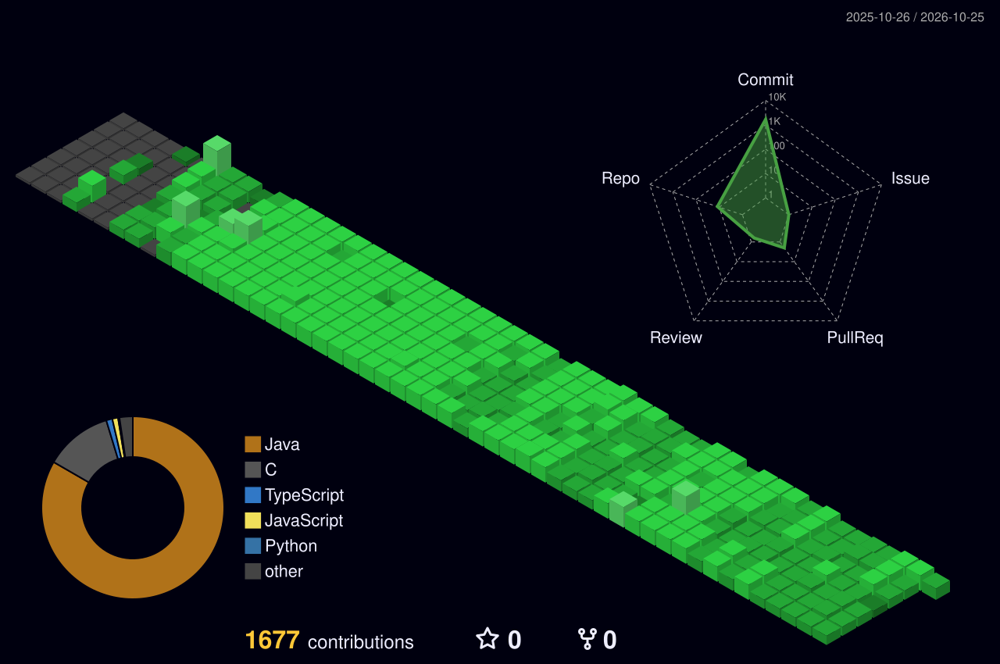

<div align="center">

  <!-- ================= BANNER ================= -->
  

  <br/><br/>

  <!-- ================= DYNAMIC TYPING SUBTITLE ================= -->
  <a href="https://git.io/typing-svg">
    
  </a>

  <br/>

  <!-- ================= SOCIAL BADGES ================= -->
  <p align="center">
    <a href="https://linkedin.com/in/aryan-gupta-58a99834a" target="_blank">
      
    </a>&nbsp;
    <a href="mailto:aryann.gupta.1ii@gmail.com" target="_blank">
      
    </a>&nbsp;
    <a href="https://leetcode.com/u/_aryan1i/" target="_blank">
      
    </a>&nbsp;
    <a href="https://codeforces.com/profile/aryan_1ii" target="_blank">
      
    </a>&nbsp;
    <a href="https://www.codechef.com/users/aryan_1ii" target="_blank">
      
    </a>&nbsp;
    <a href="https://www.geeksforgeeks.org/user/aryanngu56c8/" target="_blank">
      
    </a>
  </p>

  <!-- Profile Views -->
  

</div>

<br/>


<!-- ====================================================== -->
<!--                      ABOUT ME                          -->
<!-- ====================================================== -->

##  &nbsp;Terminal Log // About Me

```yaml
identity:
  name: Aryan Gupta
  role: B.Tech Computer Science Student & Software Developer
  location: Bengaluru, India 🇮🇳
  institution: PW Institute of Innovation (Medhavi Skills University)
  graduation: 2025 - 2029 (Currently Semester 3)
  academics:
    semester_1_cgpa: 8.81 / 10
    batch_honor: 🏅 Secured 3rd Rank in Batch (Semester 1)

interests & focus:
  - Data Structures & Algorithms
  - Backend Engineering & Database Architecture
  - Competitive Programming
  - Artificial Intelligence & Machine Learning

achievements:
  - total_problems_solved: 800+ unique problems across LC, GFG, CC, CF
  - leetcode_daily_streak: 290+ days continuous practice 🔥
  - peak_leetcode_rating: 1592
  - codechef_rating: 1268
  - icpc_india_preliminary_2026: Tentative Rank 1168
```


<!-- ====================================================== -->
<!--                   TECH ARSENAL                         -->
<!-- ====================================================== -->

##  &nbsp;Tech Arsenal

<div align="center">

### ⚡ Languages
<p>
  
  
  
  
  
  
</p>

### ⚙️ Backend, Persistence & Database
<p>
  
  
  
  
  
</p>

### 🎨 Frontend & Web
<p>
  
  
  
</p>

### 🔧 Tools, Environments & DevOps
<p>
  
  
  
  
  
  
  
</p>

### 🧠 Core Engineering Principles
<p>
  
  
  
  
</p>

</div>


<!-- ====================================================== -->
<!--             COMPETITIVE PROGRAMMING ARENA              -->
<!-- ====================================================== -->

##  &nbsp;Competitive Programming Arena

<div align="center">

  <!-- Platform Link Badges -->
  <p>
    <a href="https://leetcode.com/u/_aryan1i/" target="_blank">
      
    </a>&nbsp;
    <a href="https://codeforces.com/profile/aryan_1ii" target="_blank">
      
    </a>&nbsp;
    <a href="https://www.codechef.com/users/aryan_1ii" target="_blank">
      
    </a>&nbsp;
    <a href="https://www.geeksforgeeks.org/user/aryanngu56c8/" target="_blank">
      
    </a>
  </p>

  <!-- Highlight Stat Cards -->
  <table>
    <tr>
      <td align="center" width="25%">
        <br/>
        <sub><b>Across All CP Platforms</b></sub>
      </td>
      <td align="center" width="25%">
        <br/>
        <sub><b>Active LeetCode Streak 🔥</b></sub>
      </td>
      <td align="center" width="25%">
        <br/>
        <sub><b>LeetCode Contest Rating</b></sub>
      </td>
      <td align="center" width="25%">
        <br/>
        <sub><b>CodeChef Contest Rating</b></sub>
      </td>
    </tr>
  </table>

  <br/>

  <!-- Live LeetCode Card with Activity Heatmap -->
  <a href="https://leetcode.com/u/_aryan1i/" target="_blank">
    
  </a>

  <br/><br/>

  <!-- Codeforces Stats Card -->
  <a href="https://codeforces.com/profile/aryan_1ii" target="_blank">
    
  </a>

  <br/><br/>

  <!-- GeeksForGeeks Stats Card -->
  <a href="https://www.geeksforgeeks.org/user/aryanngu56c8/" target="_blank">
    
  </a>

  <br/><br/>

  <!-- ICPC Honor -->
  

</div>


<!-- ====================================================== -->
<!--                 CONTRIBUTION SKYLINE                   -->
<!-- ====================================================== -->

##  &nbsp;Contribution Skyline

<div align="center">

  <p><sub><i>Isometric 3D rendering of real GitHub activity · Automated daily via GitHub Actions</i></sub></p>

  <picture>
    <source media="(prefers-color-scheme: dark)" srcset="./profile-3d-contrib/profile-night-green.svg" />
    <source media="(prefers-color-scheme: light)" srcset="./profile-3d-contrib/profile-green-animate.svg" />
    
  </picture>

  <br/><br/>

  <!-- Contribution Grid Snake Animation -->
  

</div>


<!-- ====================================================== -->
<!--                   GITHUB ANALYTICS                     -->
<!-- ====================================================== -->

##  &nbsp;GitHub Analytics

<div align="center">

  <!-- Stats & Streak Side by Side -->
  <a href="https://github.com/Aryan1i">
    
  </a>
  &nbsp;&nbsp;
  <a href="https://github.com/Aryan1i">
    
  </a>

  <br/><br/>

  <!-- Top Languages Donut Layout -->
  <a href="https://github.com/Aryan1i">
    
  </a>

  <br/><br/>

  <!-- Contribution Wave Graph -->
  <a href="https://github.com/Aryan1i">
    
  </a>

</div>


<!-- ====================================================== -->
<!--                   FEATURED PROJECTS                    -->
<!-- ====================================================== -->

##  &nbsp;Featured Projects

<div align="center">

<table width="100%">
<tr>
  <td width="50%" valign="top">
    <h3 align="center">🧬 CodeDNA</h3>
    <p align="center">
      <a href="https://github.com/Aryan1i">
        
      </a>
    </p>
    <p align="center">
      
    </p>
    <p><b>Connects recruiters and students through demonstrated skills and real project work.</b><br/>Built around the core mission: <i>"Get hired for what you build, not where you study."</i></p>
    <p align="center">
      
      
      
    </p>
  </td>
  <td width="50%" valign="top">
    <h3 align="center">🗄️ JDBC CRUD Project</h3>
    <p align="center">
      <a href="https://github.com/Aryan1i">
        
      </a>
    </p>
    <p align="center">
      
    </p>
    <p><b>Engineered pure database connectivity and full transactional CRUD operations from the ground up.</b> High emphasis on connection pooling, prepared statements, and SQL sanitization.</p>
    <p align="center">
      
      
      
    </p>
  </td>
</tr>
<tr>
  <td width="50%" valign="top">
    <h3 align="center">🔗 Hibernate &amp; JPA Projects</h3>
    <p align="center">
      <a href="https://github.com/Aryan1i">
        
      </a>
    </p>
    <p align="center">
      
    </p>
    <p><b>Comprehensive ORM and relational entity mapping implementations.</b> Implements <code>One-to-One</code>, <code>One-to-Many</code>, <code>Many-to-One</code>, and <code>Many-to-Many</code> cascade mappings with lazy/eager loading patterns.</p>
    <p align="center">
      
      
      
    </p>
  </td>
  <td width="50%" valign="top">
    <h3 align="center">🧩 DSA Problem-Solving Hub</h3>
    <p align="center">
      <a href="https://github.com/Aryan1i">
        
      </a>
    </p>
    <p align="center">
      
    </p>
    <p><b>Curated archive of 800+ solved problems across LeetCode, CodeChef, Codeforces, and GeeksforGeeks.</b> Optimized for asymptotic time &amp; space complexity.</p>
    <p align="center">
      
      
      
    </p>
  </td>
</tr>
</table>

</div>


<!-- ====================================================== -->
<!--                   CODING VIBE                          -->
<!-- ====================================================== -->

##  &nbsp;Coding Vibe

<div align="center">

  <!-- 3D Coder Workshop Animation with Progressive Enhancement -->
  <picture>
    <source media="(prefers-reduced-motion: reduce)" srcset="assets/coder-workshop.png" />
    <source type="image/webp" srcset="assets/coder-workshop.webp" />
    
  </picture>

  <br/><br/>

  <!-- Dynamic Developer Quote -->
  

</div>


<!-- ====================================================== -->
<!--                 GITHUB TROPHIES                        -->
<!-- ====================================================== -->

## 🏆 GitHub Trophies

<div align="center">
  
</div>


<!-- ====================================================== -->
<!--                   CONNECT WITH ME                      -->
<!-- ====================================================== -->

## 🤝 Let's Connect &amp; Collaborate!

<div align="center">

  <p>
    <a href="https://linkedin.com/in/aryan-gupta-58a99834a" target="_blank">
      
    </a>&nbsp;
    <a href="mailto:aryann.gupta.1ii@gmail.com" target="_blank">
      
    </a>&nbsp;
    <a href="https://leetcode.com/u/_aryan1i/" target="_blank">
      
    </a>&nbsp;
    <a href="https://codeforces.com/profile/aryan_1ii" target="_blank">
      
    </a>&nbsp;
    <a href="https://www.codechef.com/users/aryan_1ii" target="_blank">
      
    </a>&nbsp;
    <a href="https://www.geeksforgeeks.org/user/aryanngu56c8/" target="_blank">
      
    </a>
  </p>

  <br/>

  <!-- Footer Banner Wave -->
  

</div>
